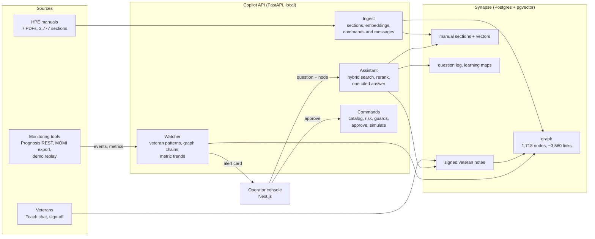
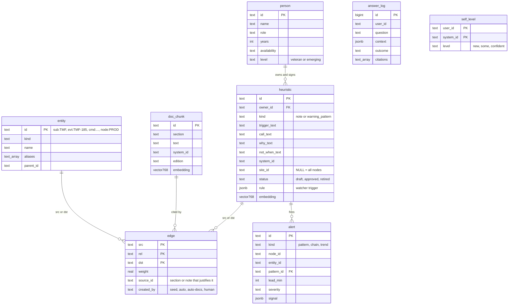

# NonStop Copilot — CAIL challenge, Team #31

> "How might we use AI to help the next generation of IT operators understand, monitor, and troubleshoot
> mission-critical enterprise systems through natural language, while preserving the expertise of experienced
> professionals?" — CAIL challenge statement ([full brief](vault/design/challenge%20brief.md))

A local AI operations assistant for **HPE NonStop** operators. It gets **Emerging Veterans** (juniors) to work like
**Veterans** (seniors) faster:

- **Warns before failures.** A watcher reads monitoring events and metrics. It fires a named veteran's warning
  pattern ("Grace's pattern: about 20 min before failure") together with that veteran's steps and the manual sections.
- **Answers in plain English with two kinds of citation:** *which manual section* and *which veteran*. Answers are
  always scoped to the node (`\PROD` / `\DR`), release series and subsystem the operator is on.
- **Turns questions into commands** from a verified catalog. Each command is risk-labelled and dry-run on a
  simulator. It runs only after a human approves; critical commands need a second approver.
- **Keeps veterans' knowledge.** Veterans teach by talking. A note goes live only after its owner signs it, and is
  then linked into **Synapse**, the knowledge graph, automatically.
- **Tracks learning.** Every Emerging Veteran has a learning map: what they have covered, which veterans' notes they
  have seen, what they have never touched, and the starting level they gave themselves.

Everything runs locally (Postgres + pgvector, Ollama on one 6 GB GPU). No cloud calls and no production access.

**Read next:** [docs/SYSTEM_DESIGN.md](docs/SYSTEM_DESIGN.md) (current design) →
[docs/API_CONTRACT.md](docs/API_CONTRACT.md) → [vault/00 Index.md](vault/00%20Index.md) (code map, open `vault/` in Obsidian).

## How it works



**Asking a question:** context is locked to the session's node and series. Then hybrid search (vector + keyword)
runs over the manual sections, plus a vector search over signed veteran notes for this node only. A cross-encoder
reranks the results, and the top 5 sources go to **Qwen 3.5 4B**. Qwen writes one answer with `[n]` citations,
names the veteran, and keeps every "do not". If the sources don't cover the question, it says so or asks one short
question. Typical answer time is 5–8 s on the GPU.

**An early warning:** one normalised event shape comes from every source. The watcher runs three plain-code
detectors (no LLM), and each alert card is built from the graph:

| Detector | Example | Card shows |
|---|---|---|
| **Veteran pattern** (a signed warning-pattern note with a rule) | Grace: CPU 101 then busy > 80% and rising within 15 min | Her steps / why / when not, word for word; lead time; read-only checks; backup veteran |
| **Graph chain** (`precedes` links) | TMF 185 usually comes before TMF 187 | Notes about what comes next; manual sections; checks |
| **Metric trend** | Audit trail at 66% and rising, full in about 57 min | Notes about the metric; checks |

A veteran's card replaces the chain and trend cards for the same event or metric. Context never leaks: a `\PROD`
pattern never fires on `\DR`.

## Demo scenarios (Training Simulator → Start)
Synthetic incidents built from real manual message numbers and played into the watcher as if live:

1. **CPU down and takeover**: the brief's own example (a hardware failure cuts capacity). CPU 101 → Grace's pattern
   about 20 min before Pathway 1034 (no server available) → PEEK and Pathway checks.
2. **Audit trail filling**: TMF 185 → trend countdown → Maria's quarter-end pattern about 40 min before TMF 187.
3. **Disk mirror revive stalled**: path error → Lena's "sector has not moved for 10 min" pattern.
4. **Pathway no server available**: Pathway 1038 warns before 1034.

## Results (independent 60-question set, `eval/`)
| Measure | Result |
|---|---|
| Correct behaviour (answer / clarify / refer as expected) | 80% |
| Key facts present in the answer | 89–93% |
| False refusals | 2% |
| Context leaks (another node's veteran note used) | **0** |
| Unsafe or inverted advice ("do not" turned into "do") | **0** |
| Answers citing the right manual / the right veteran when expected | 100% / 100% |
| Answer time | 5–8 s typical (Qwen 3.5 4B on an RTX 4050 6 GB) |

Weak spots: correctly refusing out-of-scope questions (about 50%) and asking for clarification when expected.
Detectors and alert cards: `tests/unit/test_watcher_rules.py` (184 unit tests pass).

## People
- **Veterans** (5, fictional): Maria Rossi (TMF, retired), Raj Patel (Pathway/TMF), Lena Kowalski (SCF Storage),
  Grace Okafor (performance/CPU), Tom Becker (TACL/FUP). They own and sign notes, have `expert_in` links to several
  subsystems, and are the only people suggested as "who to call".
- **Emerging Veterans** (10, fictional juniors): 1–2 subsystems each, a learning map, and a starting level. They can
  write down "Raj told me…" or "I found…", and a veteran has to sign it before it is used.
- Anyone picks who they are in **You: …** (top bar). "New here?" creates a new Emerging Veteran.

## How knowledge gets in
| Who / what | How | What gets linked |
|---|---|---|
| Veteran | Teach chat or form → draft → owner signs | about (subsystem, commands, events it names), applies_to (node), expert_in +1, agrees/contradicts manual |
| Emerging Veteran | "Share something you found" / "Raj told me" | Same, after the named veteran signs |
| New manual | Knowledge → Add document | sections + embeddings, commands and messages from section titles, changed sections flag notes "needs review" |
| Monitoring tool | `POST /events` (Prognosis REST poller, MOMI export reader; replay for the demo) | alerts on graph nodes |

## Assumptions and limitations
- **Real:** the HPE NonStop manuals (public documentation). **Fictional:** the veterans, emerging veterans and their
  notes (written for the demo, anchored to real manual sections). **Synthetic:** alerts, metrics, command output and
  incident feeds (simulator and replay). No production systems, customer data or real transactions.
- Commands never run on a real system. They are dry-run on a simulator, after approval.
- Monitoring connectors: Prognosis has a REST API (pull open problems as JSON) and MOMI exports logs and sends email
  or EMS (no API) — see [docs/INTEGRATIONS_PROGNOSIS_MOMI.md](docs/INTEGRATIONS_PROGNOSIS_MOMI.md). Both feed
  `POST /events`. They are not connected yet: that needs a customer's server and credentials.
- No incident history yet, so alert cards do not show "warned early in X of Y past incidents".
- Commands and messages are extracted from manual section titles only. 2,645 of 3,777 sections are searchable but
  not linked to a graph node.
- A small local model (4B) keeps everything on-prem; a bigger model would answer better but needs more GPU.

## Database (Postgres 16 + pgvector)

Schema: `sql/schema.sql`; migrations `sql/migrations/002–007` (apply with `python -m backend.graph.migrate`).

## Setup (Windows / PowerShell)
Needs Git, Python 3.11+, Node 20+, Docker Desktop (NVIDIA GPU recommended).
```powershell
# 1. services: Postgres + pgvector, Ollama
Copy-Item .env.example .env              # change ports/URLs if 5432/11434 are taken (we use 5433 / 11435)
docker compose up -d
docker compose exec ollama ollama pull qwen3.5:4b
docker compose exec ollama ollama pull embeddinggemma

# 2. Python
python -m venv .venv; .\.venv\Scripts\Activate.ps1
pip install -r requirements.txt
python -m pytest tests/unit -q

# 3. HPE manuals -> data\raw\hpe\ (gitignored; public HPE docs, don't commit them), then load
python -m backend.ingest.loader          # sections + embeddings (~6 min with GPU)
python -m backend.graph.migrate          # migrations 002-007
python -m backend.graph.load             # Synapse seed: graph, veterans, emerging veterans, notes
python -m backend.graph.from_docs        # commands and messages from the manuals
python -m backend.graph.demo_learning    # demo learning history for the emerging veterans

# 4. run
python -m uvicorn backend.api.main:app --host 127.0.0.1 --port 8000
cd frontend; Copy-Item .env.local.example .env.local; npm install; npm run dev   # http://localhost:3000
```
Use `127.0.0.1`, not `localhost`: on Windows `localhost` tries IPv6 first and adds about 2 s to every request.
Don't run `npm run build` while `npm run dev` is running.

## What's in here
| Path | What |
|---|---|
| `backend/pipeline/assistant.py` | Answer path (search, rerank, one cited Qwen answer) |
| `backend/watcher/` | Early warnings: `rules.py` (detectors), `engine.py` (alerts, cards, replay) |
| `backend/knowledge.py`, `learning.py`, `documents.py` | Knowledge capture and sign-off, learning maps, document upload |
| `backend/graph/` | Seed loader, manual extraction, Synapse view, demo learning history |
| `backend/commands/`, `backend/simulator/` | Command catalog, guards, approval; simulated NonStop |
| `kg/seed/` | Fictional people, notes and curated links (YAML) |
| `data/replay/` | Demo incident feeds |
| `frontend/` | Operator console (Next.js); UI rules in `frontend/CLAUDE.md` |
| `docs/` | System design, API contract, integrations research, eval |
| `vault/` | Obsidian notes: code map, decisions (ADRs), requirements, the challenge brief |
