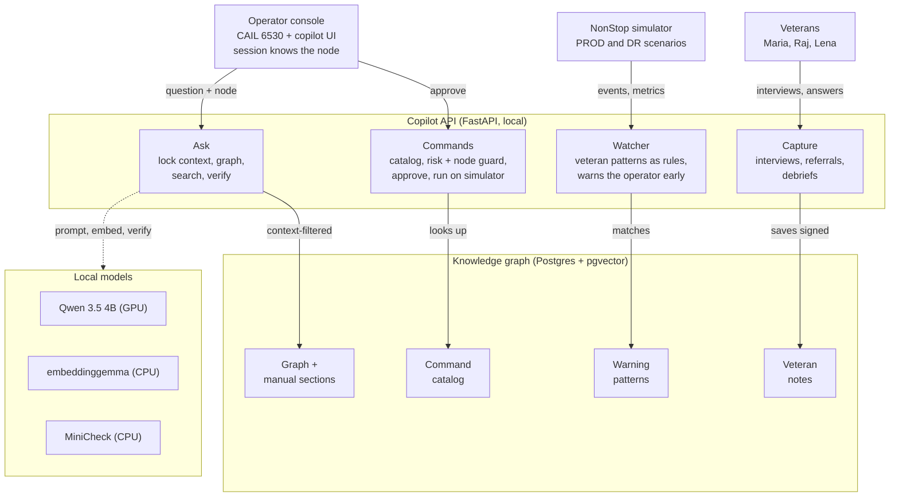
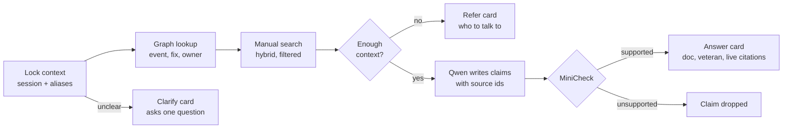
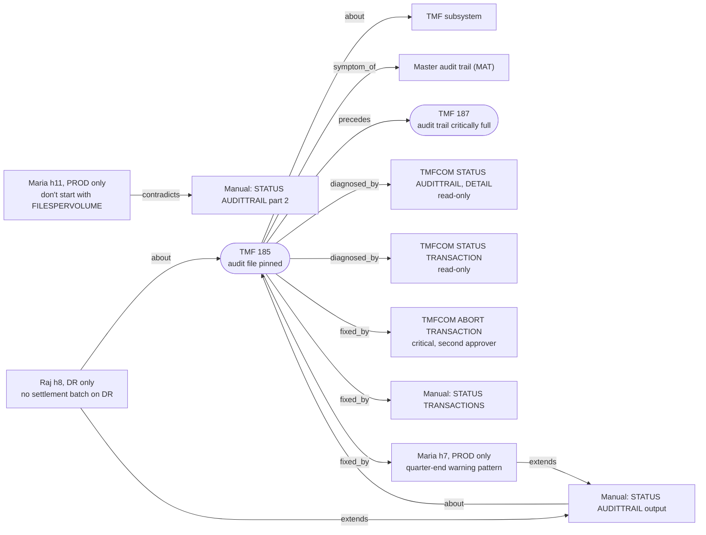
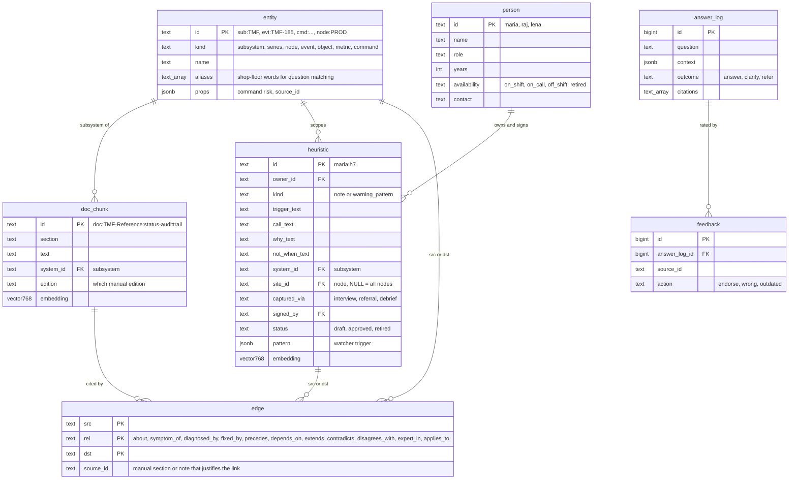

# NonStop Copilot (CAIL challenge, Team #31)

A local AI operator assistant for HPE NonStop systems. It answers with citations to the HPE manuals
and to named veterans, proposes commands that run only after approval, and warns early using
veterans' warning patterns. Every answer is scoped to the node, release and subsystem the operator is on.

**Start here:** `docs/architecture.html` (diagrams) → `docs/SYSTEM_DESIGN.md` → `docs/RAG_SPIKE.md` (measured results)
→ `vault/00 Index.md` (code map; open `vault/` in Obsidian). Claude Code reads `CLAUDE.md` automatically.

## Architecture
Full version with the command path and the knowledge loop: `docs/architecture.html` (open in a browser).



What happens when an operator asks:

Commands run on the simulator only after approval; warnings go back to the operator console. Risk classes, node/release guards and warning-pattern matching are plain code, never the LLM.

## Accuracy so far (RAG spike, `docs/RAG_SPIKE.md`)
| Stage | Result |
|---|---|
| Right manual section in top 5 (hybrid search + context filter, 27 questions) | 81% (MRR 0.74) |
| Results from the wrong subsystem: no filter → filter | 15% → 0% |
| Qwen output valid JSON / claims citing a retrieved source | 100% / 100% (29 claims) |
| Answer cites the correct manual section (10 questions) | 70% |
| Answer time, typical / worst | 3.8 s / 6.3 s |
| MiniCheck separates supported vs unsupported claims | 24 / 24, 1.3 s per claim on CPU |
| Sufficiency gate (answer vs refer) | 10 / 10 |

Preliminary: small test sets (10–27 items) written by the same agent that built the pipeline, mostly easy
negatives, manuals only (no knowledge graph yet). An independent question set is the next step.

## Knowledge graph
Manual sections and veterans' knowledge share one graph. Every link cites the manual section or note that justifies it,
and veterans' notes are scoped to the node they apply to. Full interactive view (77 nodes, 142 links):
run `python scripts/export_graph.py`, then open `docs/knowledge_graph.html` in a browser.

The `TMF 185` neighbourhood (hero scenario). On `\PROD` an operator gets Maria's notes; on `\DR` only Raj's DR note applies:

Veterans and their knowledge are fictional, written for the demo (`kg/seed/`).

## Database schema
Postgres 16 + pgvector (`sql/schema.sql`, migrations in `sql/migrations/`). Main tables:

Also: `referral` and `alert` tables for the referral loop and the watcher.

## Status (2026-10-17)
- Done: schema + context filter, manual ingest (7 HPE manuals, 3,777 chunks), hybrid search, Qwen answer
  generation, MiniCheck verifier, sufficiency gate, UI on mock data, API contract v2.
- Done since: knowledge graph (events, commands, objects, 146 cited links) + 3 fictional veterans with 10 signed notes.
- Next: `/chat` backend wired to the UI, a simple form for veterans to add notes, independent eval set.

## Setup — Windows / PowerShell
Needs: Git, Python 3.11+, Node 20+, Docker Desktop (running; NVIDIA GPU optional but recommended).
```powershell
# 1. services (Postgres + pgvector, Ollama with GPU)
Copy-Item .env.example .env              # change PG_PORT/OLLAMA_PORT + URLs if 5432/11434 are taken
docker compose up -d                     # schema auto-loads on the FIRST start of an empty volume
docker compose exec ollama ollama pull qwen3.5:4b
docker compose exec ollama ollama pull embeddinggemma

# 2. Python
python -m venv .venv
.\.venv\Scripts\Activate.ps1             # if blocked: Set-ExecutionPolicy -Scope CurrentUser RemoteSigned
pip install -r requirements.txt
pytest                                   # should pass

# 3. HPE manuals → data\raw\hpe\  (gitignored; public HPE docs, but don't commit or redistribute them)
#    Get the PDFs from the HPE NonStop Technical Library (support.hpe.com, docId a00099017en_us)
#    or ask Ghouse for the copies used here: TACL-Reference, SCF-Storage, TMF-Reference, Pathway,
#    PEEK, measure, FUP (.pdf + extracted .txt). Then load them:
python -m backend.ingest.loader          # ~6 min with GPU embeddings
python scripts/rag_spike.py --all        # optional: reproduce the numbers in docs/RAG_SPIKE.md

# 4. UI (runs on built-in mock data, no backend needed)
cd frontend; npm install; npm run dev    # http://localhost:3000
```
Schema changed? The init script only runs on an empty volume: `docker compose rm -sf db; docker volume rm veteran-kg_pgdata; docker compose up -d db`
(wipes the DB, keeps the Ollama models). Don't run `npm run build` while `npm run dev` is running.

## First Claude Code prompts (each in its own session/worktree)
1. `claude --model opusplan` → plan mode: "Read CLAUDE.md, docs/PLAN.md, sql/schema.sql. Plan the ingestion module for the docs in data/raw: chunk by section, tag system/version/site, embed with embeddinggemma, load into doc_chunk + entity + edge. Ask me about anything ambiguous in the docs."
2. "Use the implementer agent to build backend/pipeline/context.py per backend/pipeline/README.md, with unit tests."
3. UI teammate: "Build the Next.js chat UI against the mock responses in docs/API_CONTRACT.md (answer / clarify / refer cards, lanes, context chips, alerts panel)."
4. Before merging: "Use the reviewer agent on this branch."
5. Eval: "Use the test-runner agent to run python eval/run_eval.py --config 4."

## What's in here
| Path | What |
|---|---|
| `CLAUDE.md` | Rules, pipeline, stack, commands, how to work with Ghouse |
| `docs/PLAN.md` | Problem, design decisions, knowledge model, UX, loop, spin-offs, scope |
| `docs/RESEARCH.md` | Competitors, papers → design changes, Jev, model choice, costs, Claude Code practices, all sources |
| `docs/API_CONTRACT.md` | Exact JSON for /chat, /refer, /feedback, /alerts, /risk |
| `docs/EVAL.md` | How to build the golden set, metrics, ablation table |
| `docs/TEAM_AND_SCHEDULE.md` | Roles, weekend schedule, git + Claude Code usage plan |
| `docs/SYSTEM_DESIGN.md` | **NonStop/CAIL architecture (current)** — read before PLAN.md |
| `docs/PITCH.md` | 5-minute demo script |
| `sql/schema.sql` | Entity backbone + doc/person overlays + edges |
| `eval/` | Golden-set template + scoring harness |
| `.claude/` | Subagents (sonnet implementer, opus reviewer, haiku test-runner), opusplan default, Stop hook running unit tests |

Notes:
- The Stop hook (`.claude/hooks/stop_tests.py`) blocks Claude from finishing while `tests/unit` fails, at most once per stop. It calls `python`, so start Claude Code from a shell where the venv is active. If it misbehaves, remove the `hooks` block from `.claude/settings.json`.
- Check the exact MiniCheck model ID on its GitHub (github.com/Liyan06/MiniCheck) before wiring `verify.py`.
- Vector dim in `schema.sql` is 768; confirm against `embeddinggemma`'s output and adjust.
