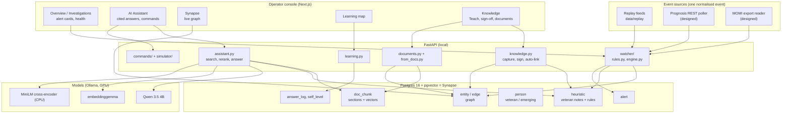
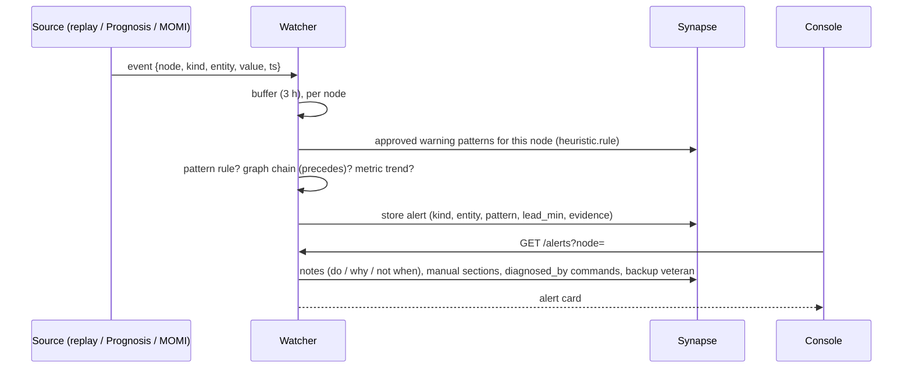

# System design — NonStop Copilot (CAIL challenge, Team #31)

Version 3 · 2026-10-17 · replaces the 2026-10-17 draft (v2). Brief: [vault/design/challenge brief.md](../vault/design/challenge%20brief.md).

## 1. Problem and goal
CAIL's customers run banking, payments and telecom on HPE NonStop. Experienced operators are retiring (about 5 of 20
at one bank in six months), and the manuals miss their practical judgment. Goal: **get Emerging Veterans (juniors)
to Veteran level faster.** Warn them before failures, explain what to do and why with citations, and capture what
the veterans know before they leave.

| Brief capability | Our feature | Status |
|---|---|---|
| 1. Natural language → commands, approved | Command catalog, risk classes, node/series guards, dry-run, 1- or 2-person approval | Built |
| 2. Understand & monitor health | Watcher: veteran patterns, graph chains, metric trends; alert cards; health charts | Built (replay feeds; connectors designed) |
| 3. Preserve expert knowledge | Teach chat, owner sign-off, automatic graph links, Synapse | Built |
| 4. Guide troubleshooting | Cited answers, "check first" commands, risks, what usually comes next, who to call | Built |
| Training speed (CAIL steer) | Learning maps, starting levels, Emerging Veterans' findings | Built; drill mode next |

## 2. The context problem ("system A and B have the same buttons")
The same command means different things depending on four things:

- **node:** `\PROD` / `\DR`
- **release series:** L, J, H
- **subsystem:** TMF, Pathway, SCF Storage, …
- **personality:** Guardian / OSS

Every manual section, note, alert and command carries a context fingerprint (`system_id` = subsystem,
`version_id` = series, `site_id` = node). A hard filter is applied in SQL before any ranking. A note signed for
`\PROD` is never retrieved, alerted on or cited in a `\DR` session; tested with 0 leaks on the 60-question set.
Manuals apply to all series and carry their edition, so an answer can say "the manual citation is from the
H-series edition".

## 3. Components

## 4. Flows

### 4.1 Ask (AI Assistant)
1. Context comes from the session's node and series. If the question names the other node, it asks which one.
2. Retrieval:
   - hybrid search over `doc_chunk` (vector + IDF keyword, RRF) inside the context filter, 20 candidates;
   - vector search over signed notes for this node, 6 candidates.
3. The MiniLM cross-encoder reranks the candidates. Final order is RRF of search rank and rerank rank; nothing is
   dropped on score alone. Top 5 sources, 1,000 characters each.
4. One Qwen call with the last 3 turns, so follow-ups work. Rules for the answer:
   - cite `[n]`;
   - name the veteran and keep every "do not";
   - use a source only if it answers the question;
   - otherwise say it isn't covered, or ask one short question;
   - about 120 words.
5. Citations are mapped back to sources. "Who knows this" lists **veterans only**, ranked by `expert_in` weight
   and availability. Proposed commands come from the catalog.
6. Logged to `answer_log` per user. This feeds the learning map.

### 4.2 Warn (watcher)

- **Rules** are small JSON shapes stored on the veteran's note:
  - `count`: event X ≥ N times in W minutes, optionally with a metric above a threshold and rising;
  - `stalled`: a metric unchanged for N minutes.
- **Trend:** a straight-line projection to a hard limit; warns within 60 min, critical within 20.
- **De-duplication:** one open card per (kind, key, node). A veteran's card closes and suppresses the chain and
  trend cards for the same event or metric.
- **No LLM** in detection: explainable, fast and testable (`tests/unit/test_watcher_rules.py`).

### 4.3 Capture and sign (Veterans)
1. Teach chat: the veteran talks, Qwen asks one follow-up at a time, then drafts trigger / do / why / not-when plus
   node and subsystem. The veteran edits it and saves a **draft**. Drafts are never retrieved.
2. Only the owner can sign (403 otherwise). Signing does four things:
   - embeds the note;
   - adds `about` links to the subsystem and to the commands, events and objects the text names, inside the
     same subsystem only;
   - adds `applies_to` the node;
   - adds `expert_in` +1 for the owner.
3. The system suggests related manual sections; the veteran marks each `extends` or `contradicts`.
4. Emerging Veterans can enter "Raj told me…" or "I found…" with `entered_by` = themselves. It stays a draft until
   that veteran signs it.

### 4.4 Learn (Emerging Veterans)
- The learning map comes from `answer_log`. Cited sections and notes are followed along their `about` links to
  the graph nodes "touched". Coverage = touched / nodes per subsystem.
- It shows the veterans learned from, what has never been touched, recent questions, and the starting level per
  subsystem (`self_level`, self-reported, never used to answer).
- **Next: drill mode.** Replay a past incident, have the junior answer, compare with the veteran's note, and record
  the score on the map.

### 4.5 Ingest documents
- Upload a PDF or text file. It is split into sections and embedded, and added to `doc_chunk` with its edition.
- `from_docs` then extracts commands and numbered messages from section titles (deterministic, no LLM), links
  them to their section and subsystem, and removes stale ones.
- Re-uploading shows added / changed / removed sections and flags notes tied to changed sections "needs review".

### 4.6 Commands
- The catalog (`kg/seed/entities.yaml`) holds each template's risk class:
  - `read_only`: one click;
  - `state_changing`: the operator types the node;
  - `critical`: a second approver.
- Guards: node match and supported series.
- Dry-run shows expected output and blast radius. Execute runs on the simulator only; the output becomes a "live"
  citation.

## 5. Data model (Synapse)
| Table | Holds | Notes |
|---|---|---|
| `entity` | subsystems, series, nodes, events, commands, objects, metrics | 1,718 (1,662 extracted from manuals) |
| `edge` | about, applies_to, symptom_of, diagnosed_by, fixed_by, precedes, depends_on, extends, contradicts, disagrees_with, expert_in, mentions | each cites a `source_id`; `created_by` = seed / auto / auto-docs / human |
| `doc_chunk` | 3,777 manual sections, 7 manuals, 768-d vectors | context columns + edition |
| `heuristic` | veteran notes and warning patterns | owner, scope, status, provenance, `rule`, vector |
| `person` | 5 veterans, 10 emerging veterans | `level` |
| `answer_log`, `self_level` | per-user questions and citations; starting levels | learning maps |
| `alert` | watcher alerts | kind, node, entity, pattern, lead time, evidence |

## 6. Integrations (existing monitoring tools)
One normalised event (`POST /events`): `{node, kind: event|metric, entity, value, tool, text, ts}`. The demo replays
recorded feeds through the same path.

| Tool | How it exposes alerts | Our adapter | Status |
|---|---|---|---|
| IR Prognosis | REST API: admin-defined PQL datasets as JSON over HTTPS, e.g. open problems (`/Prognosis/Rest/v1/data/<id>`); SNMP traps | Poll every 10–30 s; SNMP as fallback | Designed; needs a customer endpoint |
| BlackWood MOMI | No API. Alarms → email, EMS, log; scheduled history/log exports | Watched export folder; email sink as an option | Designed |
| Third tool | Unknown | Ask CAIL | — |

The alarm-name → graph-node mapping is done in advance, so an incoming alert lands on a node with its notes and
manual sections already linked. Details: [INTEGRATIONS_PROGNOSIS_MOMI.md](INTEGRATIONS_PROGNOSIS_MOMI.md).

## 7. Models and performance
- **Qwen 3.5 4B** (Ollama, GPU, kept loaded for 60 min). Answers and Teach drafts only; it is never used for
  detection, risk or guards.
- **embeddinggemma** for embeddings. **ms-marco MiniLM** cross-encoder for reranking (0.7 s on CPU).
- Latency: 5–8 s per answer. The first answer after a model reload takes about 25 s. Use `127.0.0.1`, not
  `localhost` (IPv6 adds about 2 s on Windows).
- Eval (60 independent questions): 80% correct behaviour, 89–93% key facts, 2% false refusals, 0 context leaks,
  0 unsafe inversions.

## 8. Safety and trust
- Advisory only: there is no path to a real system, and commands run on the simulator after approval.
- Every claim has a source: a manual section with its edition, or a named veteran with when and how it was captured.
  It says when something isn't covered.
- Unsigned knowledge is never used. Contradictions with the manual are shown, not hidden.
- Detection, risk classes and guards are plain code.

## 9. Limitations and next steps
| Limitation | Next step |
|---|---|
| No incident history, so no "warned early in X of Y" | Record alerts and outcomes; backtest rules |
| Graph links come from section titles only (2,645 sections unlinked) | Body-text "mentions" links (deterministic) |
| Answer path uses graph links only for experts | Follow one hop from named nodes into extra sources |
| Connectors designed, not connected | Prognosis poller + MOMI folder reader once CAIL provides a sample |
| No drill mode | Replay incidents as exercises, score on the learning map |
| 4B model quality | A larger local model if hardware allows |
